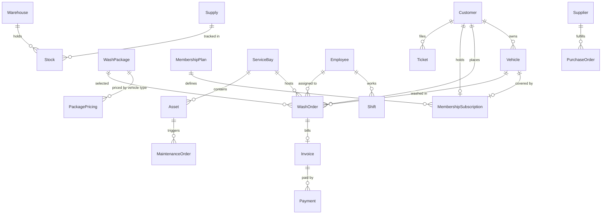
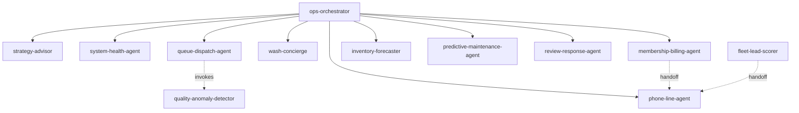
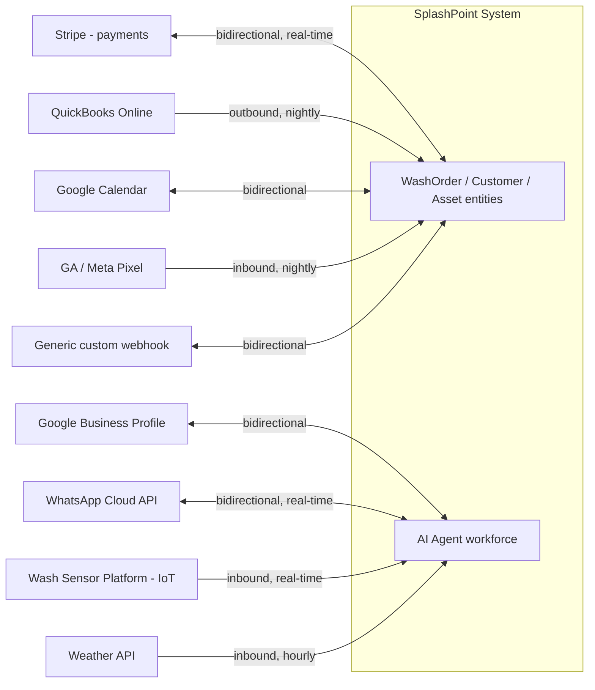

# Multiple Views

*Part of the Intelligence cluster. Compiled from `bir.json`.*

Eight views compiled - single-location scale collapses what would be a separate Board View
into the Executive View, but keeps Field/Technical distinct because the wash floor and an
engineering audience genuinely need different things from everyone else.

---

## Executive/Owner View
**Audience**: `owner` · **Cadence**: daily (real-time available) · **Medium**: whatsapp-digest

Leads with the health score, then `cars-washed-per-day`, `membership-penetration-rate`,
`net-membership-growth`, then *only* open anomaly alerts - never raw data. Includes:
`healthScore`, `cars-washed-per-day`, `membership-penetration-rate`, `net-membership-growth`,
`revenue-by-bay-daily`, open anomaly alerts.

## Operations View
**Audience**: `site-manager` · **Cadence**: real-time · **Medium**: in-app

The busiest screen in the system. Includes: today's `WashOrder` queue by status, the 6-bay
status board, `shift-no-show-alert` list, open `MaintenanceOrder`s, open `Ticket`s.

## Financial View
**Audience**: `owner` · **Cadence**: monthly · **Medium**: emailed-report

Includes: profit-and-loss, cash-flow, ar-aging, `package-tier-margin`, budget-vs-actual.

## Customer/CRM View
**Audience**: `site-manager` · **Cadence**: weekly · **Medium**: in-app

Includes: segment sizes and movement, at-risk-member list, campaign performance,
`crm.customer360Includes`.

## Team/HR View
**Audience**: `site-manager` · **Cadence**: weekly · **Medium**: in-app

Includes: `Shift` schedule and coverage gaps, `technician-throughput`, payroll status.

## Growth/Marketing View
**Audience**: `owner` · **Cadence**: weekly · **Medium**: in-app

Includes: funnel stage volumes, `marketing.adCampaigns` ROI, social-media analytics,
`true-blended-cac` (from `data-aggregation.md`).

## Field/Mobile View (Bay Floor)
**Audience**: `bay-attendant` (and by extension wash-technician/detail-technician) ·
**Cadence**: real-time · **Medium**: in-app

Minimal, action-oriented, works on a phone, tolerant of poor connectivity (queues the
qc-passed/qc-failed action offline and syncs on reconnect - a wash bay's phone signal is not
guaranteed). Includes: queue board, assigned-technician-today list, one-tap qc-passed/
qc-failed action.

## Technical/Architecture View
**Audience**: engineering team · **Cadence**: on-demand · **Medium**: diagram

### Entity-relationship diagram (core entities)

### Agent org chart

### System/integration map

---

Medium/cadence choices were deliberate: the owner gets a WhatsApp digest (checking in between
tasks, not logging into a dashboard); the bay floor gets push-style in-app actions tolerant of
poor connectivity, not the full back-office UI shrunk down; the Financial View is an emailed
report because monthly review happens off-shift, not glanced at mid-shift.
